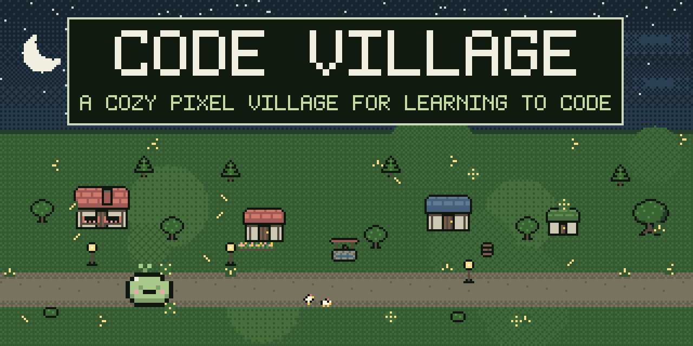

<h1 align="center">Code Village</h1>

<b><a href="https://code-village.dev">Play at code-village.dev</a></b> 
In your browser. Nothing to install, no account needed.

  
  
  
  
  
  
  
  

## What it is

Code Village is a cozy pixel village where the way forward is writing code. A lesson teaches a
small piece of Python and then hands you a task. Your code runs in the browser and the tests say
whether it works. Clear a region and its boss wakes up. Beat the last boss of a world and its
trophy opens the road to the next one. Keep your garden watered and the lessons you have
forgotten come back for a review. Pass enough of them and the village itself grows: new
buildings, lanterns, villagers, and a wider map.

## What you get

- Three worlds in Python: the Village, the Forest, and the Mountains. A welcome tour, then 33
  lessons, 99 tasks and 9 bosses, from your first `print` to a small machine learning model.
- Lessons with hands-on tasks, checked in your browser by real Python.
- Bosses to defeat in their lairs, with a hard mode for a second trophy.
- A garden that remembers what you forget and asks you to review it.
- A village that grows with you and follows your clock and calendar.
- A house that keeps every item and trophy you have found.
- A library with a searchable recap and a mock exam, and a sandbox to try anything.
- A Socratic teacher: ask about the task in front of you and get a nudge, never the answer.
- The village board: see who has reached where, all time or this week.
- Connect your own coding agent (Claude Code, Codex, or opencode) to the same task and progress.
- Works offline once the Python runtime is downloaded.
- A lighter map on slower machines, so the village keeps moving.

## How a lesson works

Each world teaches in its own building: the School in the Village, the Ranger's cabin in the
Forest, and the Observatory in the Mountains. A lesson is a notebook on the left and a slate on
the right.

- **The notebook** explains one idea in short steps. Its examples are real code: edit them, press
  Run, and see what they print. Some stop to ask "What does this print?" so you guess before you
  look.
- **The slate** holds the task. Write your code, press Run to try it, and press Check to run the
  tests. You see which tests pass and which fail, and why.
- **Hints** open one at a time, two per task. A task is worth 15 XP without hints, 10 XP after
  one, and 8 XP after both.
- **The teacher** reacts to every Check and tells you what comes next.

Pass every task and the lesson is done: you find an item for your house or the map, and a seed
goes to your garden.

## Three worlds

Each world has its own teacher, its own building and three regions. Every region ends with a
boss.

| World             | Teacher                            | Regions                                | Opens with                                            |
| ----------------- | ---------------------------------- | -------------------------------------- | ----------------------------------------------------- |
| **The Village**   | Ms. Juniper, at the School         | First programs, Collections, Structure | You start here                                        |
| **The Forest**    | Ranger Noa, at the Ranger's cabin  | Classes, Behaviour, Families           | The Ruin Lantern, which lights the forest path        |
| **The Mountains** | Stargazer Alex, at the Observatory | Data, Numbers, A first model           | The Ranger's Badge, which gets you over the rockslide |

<b>Every lesson, in order</b>

**The Village**

| Region         | Lessons                                                                                                                 | Boss               |
| -------------- | ----------------------------------------------------------------------------------------------------------------------- | ------------------ |
| First programs | Hello, Code Village (the welcome tour) · Values, types and variables · Input, output and f-strings · Conditions · Loops | The Guessing Stone |
| Collections    | Strings · Lists · Lists of lists · Dicts, tuples and sets · Comprehensions, zip and enumerate                           | The Gradebook      |
| Structure      | Functions · Errors and debugging · Recursion                                                                            | The Lost Satchel   |

**The Forest**

| Region    | Lessons                                                                                                                | Boss                    |
| --------- | ---------------------------------------------------------------------------------------------------------------------- | ----------------------- |
| Classes   | Classes and objects · Methods that change, methods that answer · Identity and equality · Class and instance attributes | The Squirrel Storehouse |
| Behaviour | Properties and validation · Dunder methods · Sortable objects · Dataclasses                                            | The Songbird Playlist   |
| Families  | Inheritance · Composition · Testing with assert                                                                        | The Ranger's Registry   |

**The Mountains**

| Region        | Lessons                                                                                 | Boss                |
| ------------- | --------------------------------------------------------------------------------------- | ------------------- |
| Data          | Functions as values · Generators · Files, with and JSON · Tables with pandas            | The Sales Report    |
| Numbers       | NumPy arrays · Mean, median and spread · Searching fast                                 | The Data Summary    |
| A first model | The nearest neighbour · k nearest neighbours with scikit-learn · Testing a model fairly | The Star Classifier |

## Bosses

Each region's boss sleeps in its lair on the map: the quarry, the marsh, the ruins, and more
further out. It wakes up when you finish the region's lessons.

A boss is one bigger program, built in stages. Every stage you pass takes a chunk off its HP and
pays 40 XP. Check runs every stage's tests, and a beaten stage stays beaten, so you can work
through it at your own pace. Beating it pays another 100 XP and a trophy. The last bosses of the
Village and the Forest hold the keys to the next world.

- **Hard mode.** Once a boss is beaten, try its hard mode: no starter code, more tests, and 5
  Checks per attempt. Win that too for a second trophy and 150 XP.
- **Rematch.** Fight a beaten boss again from a fresh start, for practice. It pays no XP, and your
  trophies stay.
- **Test out.** Already know a world? Challenge its final boss while it is still asleep. Win, and
  every lesson of that world counts as done and its bosses as beaten. Hard mode is still yours to
  win.

## The garden

Every concept you learn plants a seed. A plant wants water now and then, and watering it means
one short review exercise on that concept.

- Water on time and it grows: seed, sprout, flowering, tree. Each stage waits longer for the next
  watering: 1 day, then 3, then 7, then 21.
- Get a review wrong and the plant drops back a stage and asks again tomorrow.
- Leave a plant two days past its watering and it starts to wilt. Water it to perk it up.
- Each review you pass is worth 5 XP. A plant that grows into a tree scatters wildflowers along
  the paths of its world.

## A village that lives

XP raises your level, up to level 11, and each level adds something to the map: a windmill and a
wheat field, a market stall, a fountain on the square, lanterns along the roads, deer and
rabbits in the forest glades, and new villagers moving in. Every lesson also gives you an item:
most of them change the map, and the rest are kept in your house.

The villagers keep their own daily routines, and the village keeps your time. Dawn, day, dusk and
night follow your clock, the seasons follow the real date (snow on the pines in winter), and the
weather changes from day to day.

## Your house

Your house keeps score: your level, your XP, how many lessons and bosses you have done, and how
many plants are in bloom. Its shelf holds every item and trophy you have found, with empty slots
hinting at what is still out there. It is also where you join the board, connect your agent,
replay the tour, and delete your nickname if you ever want to.

## Around the village

- **The Today card** always says what to do next: the next lesson, the plants to water, or the
  boss that is awake.
- **The library** has the recap: what each lesson asked you to remember, with a search that
  finds any word. It also runs a mock exam, one exercise per concept in mixed order. It pays a
  little XP and never changes your plants.
- **The sandbox** is a free notepad. Write any Python, give `input()` some lines, and run it. Your
  draft stays in your browser.
- **The board** shows who has reached where, all time or this week. Join it from your house with
  a nickname.

## The teacher

Stuck on a task? Ask the teacher about it, in English or French. The teacher works the Socratic
way: one question or one nudge at a time, never the answer. The nudges get more specific the
longer you are stuck. First the teacher asks what you expected to happen. Then it points at the
line or the failing test that shows the problem. Then it names the idea to review or the one
small change to look at. There is no magic phrase that makes it spoil the task, and if you get
frustrated, the steps just get smaller.

The teacher reads the task and the code from your last Check, so press Check before you ask. To
ask the teacher, join the board from your house first. Each player gets 25 questions a day.

## Bring your own coding agent

If you already use Claude Code, Codex, or opencode, you can bring it into the village. Once you
have joined the board, make an agent token in your house and paste the setup shown for your
tool. Your agent can then see the task you last pressed Check on, with that code and its test
results, plus the lesson text and your progress. It never gets the test code or the solutions,
and it gets the same rules as the village teacher. You can revoke the token at any time.

No agent connected? The "Copy for my agent" button in a lesson copies the teacher's rules, the
task, and your last checked code and results, ready to paste into any agent.

## Your progress

Without an account, your progress lives in this browser only. Join the board and it is also kept
on the server, so you can move it to another device with the recovery code you get when you
join. Write that code down somewhere safe.

Using the recovery code signs out your other devices and revokes your agent tokens, so you play
on one device at a time.

## Playing on any machine

- **Keyboard.** When you are not typing in the editor or a text box, keys 1 to 7 jump between the
  Village, School, Garden, Library, House, Sandbox and Board, and Esc takes you back.
- **Sound.** Soft sounds, off until you turn them on in the top bar.
- **Slower machines.** The map switches itself to a lighter mode, so the village keeps moving.

## Privacy

You can play without an account, and your progress stays in your browser. If you join the village
board, the server keeps your nickname, your progress and the code you write for the tasks, and
nothing else. Your code is kept so your progress can follow you to another device and so the
teacher can see your last Check. Your IP address is never stored: only a salted, daily hash is
used to limit abuse. The teacher sends your question and your code to Cloudflare's model, which
does not train on them.

Your code is also sent, without your nickname, when you press Report a problem, and when Check
looks wrong (your code passes every hidden case but fails a visible test), so the task can be
fixed. You can delete your nickname, and everything stored with it, from your house at any time.
A nickname nobody has used for a year is deleted the same way.

## FAQ

**Do I need to install Python?** No. Python runs inside the page, so a browser is all you need.

**I already know some Python. Do I have to start from the first lesson?** No. Once a world's road
is open, you can test out of it (see Bosses).

**Which browsers?** A current Chrome, Edge, Firefox, or Safari, on a computer or a phone.

**Does it work on a phone?** Yes. The village fits small screens, though writing code is easier
with a keyboard.

**How much data does it use?** The first time you run code, the Python runtime is downloaded
(about 15 MB) and then kept. The Mountains lessons use NumPy, pandas and scikit-learn, which add
about 25 MB the first time your code imports them. Anything already downloaded keeps working
offline.

**Can I play on two devices?** One at a time. Join the board, then use your recovery code on the
other device. That signs out the first one (see Your progress).

## License

Code Village is © 2026 CassetteTapeCrackle, licensed under the
[GNU Affero General Public License 3.0](LICENSE). You may run, change and share it. If you host a
changed copy for other people, you must share its source under the same license.

The Departure Mono font keeps its own license, in `src/styles/fonts/DepartureMono-LICENSE.txt`.
